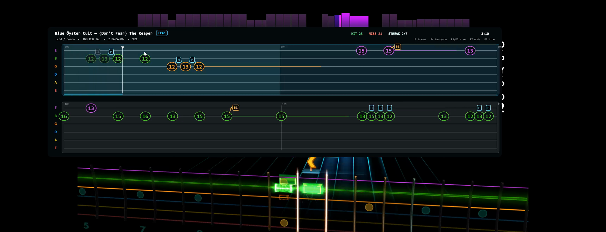
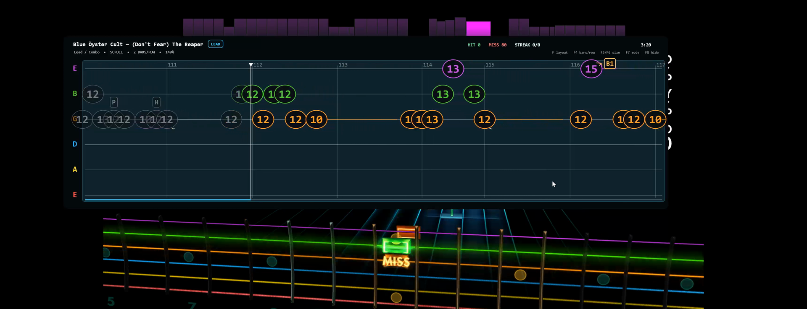
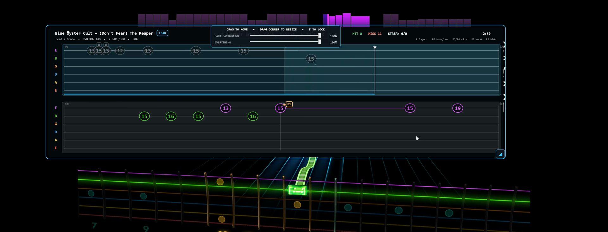

# Rocksmith TAB Overlay

A synchronized six-string tablature overlay for **Rocksmith 2014 Remastered**.
It reads the active arrangement from the installed `.psarc`, follows Rocksmith's
live song clock through a patched RockSniffer server, and draws ordinary TAB over
the game. No chart conversion or duplicate TAB file is required.



## Features

- Rolling two-row TAB page (default) and a continuous scrolling view. The current
  row stays on top; the lower preview is promoted when the current row finishes.
- Adjustable logarithmic scroll compression keeps the next notes spacious while
  fitting progressively more distant bars into the same view.
- Lead, Rhythm, and Bass paths, with the live path badge.
- Chords, colored sustains, fret-to-fret slide slopes, tremolo-picking zigzags,
  bend arrows, H/P legato connectors, vibrato, taps, slap/pop marks, measure
  numbers, and the current playhead.
- Live hit, miss, and streak totals. Finished notes retain a muted string color;
  misses that can be correlated with Rocksmith's live counters turn gray.
- Click-through, always-on-top overlay that follows the Rocksmith client window.
- Automatically hides while Rocksmith is not the foreground window or no
  playable song is active, so a cached previous chart cannot remain on screen.
- DPI-aware, resolution-independent layout.
- Remembers mode, bars per row, notation size, and scroll-compression strength.

## Views and layout

The default two-row view behaves like a rolling page: play through the upper row,
then the lower preview is promoted to the top. The playhead always stays on the
upper row, so the TAB does not disappear underneath it. The selected bars-per-row
value is a maximum: dense passages borrow space from rests and automatically use
fewer bars when necessary, keeping fret numbers separated and full-size.

Press `F7` for a continuous Songsterr-style view. Notes move through a fixed
playhead while completed notes dim and correlated misses turn gray. Press `F9`
to cycle linear, light, medium, and strong future-bar compression. Dense runs
automatically keep enough engraving space for full-size fret numbers, so the
curve compresses empty rhythmic space instead of shrinking or stacking notes.



Press `F` to unlock the overlay. You can drag it, resize it from the lower-right
corner, and separately change the dark background and whole-TAB opacity. Click
**Restart overlay** to relaunch it without closing Rocksmith, or press `F` again
to save the layout and make the overlay click-through.



## Requirements

- Windows 10 or 11, x64.
- Rocksmith 2014 Remastered.
- Rocksmith in **borderless/windowed** mode. Windows blocks overlays over
  exclusive-fullscreen games.
- Either the self-contained release, or the **.NET 8 Desktop Runtime** (or a
  newer major runtime; the app rolls forward).
- Administrator approval. Rocksmith commonly runs elevated, so the launcher
  elevates RockSniffer and the overlay to the same integrity level.

## Install

1. Download the latest `RocksmithTabOverlay-*-win-x64.zip` from the
   [Releases](https://github.com/GrzegorzAndrys/rocksmith-tab-overlay/releases)
   page.
2. Extract it to a writable folder. Do not put the runtime data in a read-only
   location such as `C:\Program Files`.
3. Run `start-tab-overlay.ps1` and accept the UAC prompt.
4. Start Rocksmith, select a song and an arrangement, and play. The overlay
   appears when Rocksmith is the active window.

If PowerShell blocks local scripts, run:

```powershell
powershell -NoProfile -ExecutionPolicy Bypass -File .\start-tab-overlay.ps1
```

The launcher can be started before or after Rocksmith. The display reconnects to
the active arrangement automatically. The first song may take a few seconds
while RockSniffer indexes installed `.psarc` charts; later songs use the local
cache.

## Controls

| Key | Action |
| --- | --- |
| `F` | Unlock/lock layout editing; move, resize, and adjust background/content opacity |
| `F4` | Cycle a maximum of 2, 4, 6, or 8 bars per row |
| `F5` / `F6` | Shrink or enlarge notation (70% to 150%) |
| `F7` | Toggle two-row TAB page / continuous scroll |
| `F8` | Show or hide the overlay |
| `F9` | Cycle linear, light, medium, or strong scroll compression |

The overlay is click-through while locked. Press `F` to enter layout-edit mode,
drag anywhere on the overlay to move it, drag the highlighted lower-right corner
to resize it, and use the two sliders to fade either the dark background alone or
the entire TAB layer. The same panel can restart the overlay while leaving
Rocksmith open. Press `F` again to save and return to click-through mode.
Custom bounds are stored relative to Rocksmith's client area, so the placement
scales sensibly when the game resolution or Windows DPI changes.

## Display and refresh-rate behavior

There is no hardcoded resolution or frame rate:

- The overlay gets the Rocksmith **client rectangle** from Win32, converts it to
  WPF device-independent units, and sizes itself to that rectangle. Its height is
  `47%` of the client height, bounded at `320–680` DIP, and it leaves a 12 DIP
  top offset.
- The application manifest declares **PerMonitorV2** DPI awareness. Text is
  measured with the monitor's real `pixelsPerDip`, and render positions are
  snapped to physical pixels. Windows scaling from 100% to 200% is supported;
  the layout is recalculated when the game window changes.
- Scroll time is driven by a monotonic `Stopwatch` and corrected by RockSniffer
  clock samples. The overlay measures the live song-clock rate, so Riff Repeater
  speed changes remain smooth instead of repeatedly pulling a `1.0x` prediction
  back into sync. Rendering is driven by `CompositionTarget.Rendering`, so it
  follows the monitor's refresh rate (60, 120, 144, 165, 240 Hz, and so on).
  Scroll speed does not depend on FPS.
- Very high refresh rates naturally cost more GPU/CPU time because WPF repaints
  once per composition frame. If that matters on a 240 Hz display, run the
  monitor at 120/144 Hz while playing; the TAB speed stays the same.

The layout is tuned by user controls, not by a fixed monitor model: 2 bars per
row at 70% notation is comfortable on an ultrawide, while 4–8 bars per row works
better on narrower displays. The defaults are 4 bars per row and 100% notation.

## Settings

Preferences are stored at:

```text
%LOCALAPPDATA%\RocksmithTabOverlay\user-settings.json
```

This includes the view controls and optional custom overlay position/size. Older
builds stored `user-settings.json` next to the executable. That file is read once
and migrated automatically.

## Build from source

Install the [.NET 8 SDK](https://dotnet.microsoft.com/download/dotnet/8.0), then:

```powershell
.\build.ps1
```

The output is written to `dist/` with `RockSniffer/`, `Overlay/`, the launchers,
and license notices.

Useful options:

```powershell
# Include the .NET runtime so users do not need a separate install
.\build.ps1 -SelfContained

# Build into a separate folder without touching a live dist install
.\build.ps1 -OutputRoot dist-next -Clean

# Create artifacts/RocksmithTabOverlay-<version>-win-x64.zip
.\build.ps1 -Clean -CreateArchive
```

`build.ps1` uses `dotnet` from `PATH` by default. Pass `-Dotnet C:\path\to\dotnet.exe`
to use a specific SDK. The build publishes both the vendored RockSniffer backend
and the WPF overlay.

GitHub Actions builds every push and pull request. Pushing a tag such as
`v0.1.0` builds a self-contained package and publishes a GitHub release.

## Project layout

| Path | Purpose |
| --- | --- |
| `src/RocksmithTabOverlay/` | WPF overlay, TAB renderer, clock, settings |
| `vendor/RockSniffer/` | Modified MIT-licensed RockSniffer clock/PSARC backend |
| `build.ps1` | Local and CI build/publish script |
| `start-tab-overlay.ps1` | User-facing UAC launcher |
| `run-sniffer-elevated.ps1` | Starts the backend and overlay at the same privilege level |
| `diagnose-overlay-window.ps1` | Writes `window-diagnostic.json` for display/attachment troubleshooting |

## Current limitations

- Renders the authored **maximum difficulty** chart. It does not mirror Rocksmith's
  dynamic-difficulty omissions.
- Rocksmith exposes aggregate hit/miss counters rather than per-note judgments.
  Miss highlighting is therefore best-effort, and is deliberately conservative
  when several judgments arrive in the same polling sample.
- Harmonics, palm muting, and per-string techniques inside complex chords need
  richer flag decoding in a later pass.
- The game process name is `Rocksmith2014`, and the default RockSniffer endpoint
  is `http://127.0.0.1:9938/tab`. These are integration points, not display
  assumptions. If your RockSniffer port differs, set `SnifferUrl` in
  `%LOCALAPPDATA%\RocksmithTabOverlay\user-settings.json` to the full endpoint.
- Exclusive fullscreen is not supported by Windows overlays; use borderless or
  windowed mode.

## Credits and license

Rocksmith TAB Overlay is MIT-licensed; see [LICENSE](LICENSE).

It vendors and modifies [RockSniffer](https://github.com/kokolihapihvi/RockSniffer)
(MIT) and its libraries. See [THIRD_PARTY_NOTICES.md](THIRD_PARTY_NOTICES.md) and
[`vendor/README.md`](vendor/README.md) for provenance and local changes.

Rocksmith 2014 and its content belong to their respective owners. This project
does not ship game assets or charts; it reads charts from your installed game.
